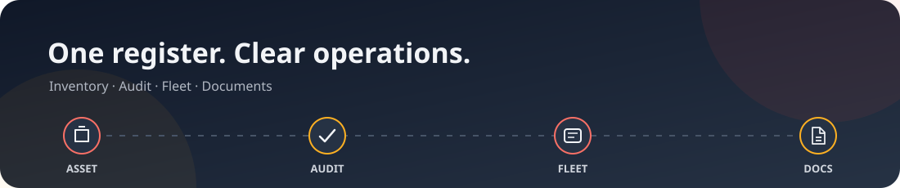
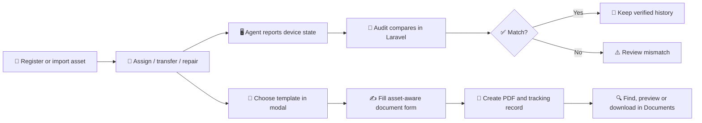

<div align="center">

# 📦 TRACKER-ASSET

### Asset operations, made clear.




**🔍 Inventory · 🔎 Audits · 🖥️ Live Fleet · 🔄 Transfers · 📄 FAT/BAST · 📊 Reports**

An IT asset operations platform for MITO Group, replacing spreadsheet-led inventory,
manual device audits, and copy/paste document preparation with one auditable workflow.

</div>

---

## 🚀 What it does

- **📋 One asset register** — searchable inventory, master data, attachments, transfers,
  repairs, assignment history, and activity trail.
- **🖥️ Live Windows fleet** — agent telemetry, online/offline state, battery and disk health,
  scan/update commands, and per-device progress.
- **🔎 Server-side audits** — compare reported hardware with registered values; mismatches
  are reviewed explicitly and never silently overwrite the register.
- **📄 Documents that stay findable** — generate FAT/BAST and other PDFs from asset data and
  templates; `/documents` tracks generated records across the whole register.
- **🔐 Controlled access** — admin, support, technician, and viewer roles; local sign-in or
  optional Microsoft Entra ID SSO.
- **📊 Operations visibility** — `/services` lists project engines, backing services,
  endpoints, and optional integrations with explicit health states.

## 🔄 Current workflows



The web application is the system of record. The Windows agent collects and reports data;
it does not decide whether inventory values are correct. See
[`docs/architecture.md`](docs/architecture.md) and [`docs/README.md`](docs/README.md).

## 📦 Install a fresh local copy

### Recommended: Docker Compose

Requirements: Git and Docker Engine with the Compose v2 plugin (Docker Desktop on Windows).

```bash
git clone https://github.com/masmbull/TRACKER-ASSET.git
cd TRACKER-ASSET
cp .env.example .env
```

Edit `.env` locally with environment-specific values. **Do not commit or share it.**
Generate the Laravel application key before starting the stack:

```bash
docker compose build
docker compose run --rm --no-deps -e RUN_MIGRATIONS=false app php artisan key:generate
docker compose up -d
```

The app container waits for PostgreSQL, applies migrations, and seeds non-user reference
data. It does not create a shared/default login. Provision the first administrator
interactively; password input is hidden and is not written to the database in plain text
or printed in the command output:

```bash
docker compose exec app php artisan tracker:admin:create
```

Open **http://localhost:8000** and sign in using the email and password you entered.
The first administrator can add other accounts under **Access Control**.

Useful commands:

```bash
docker compose logs -f app
docker compose exec app php artisan test
docker compose exec app php artisan schedule:list
docker compose down
```

> `docker compose down -v` removes database and Redis volumes. Use it only when you
> intend to delete local data.

### 💻 Local PHP development

Use PHP 8.4, Composer, Node.js 22+, and a configured database. Then:

```bash
composer install
cp .env.example .env
php artisan key:generate
npm ci
php artisan migrate --seed
npm run build
php artisan tracker:admin:create
php artisan serve --port=8000
```

For a continuously rebuilding front end, run `npm run dev` in a separate terminal.
Detailed database and Windows instructions: [`docs/local-development.md`](docs/local-development.md).

## 🌍 Production deployment

Production runs the versioned Docker image from GitHub Container Registry; the server
does not need a source checkout. Configure the server-side `.env` and GitHub Actions
deployment variables/secrets in their respective secure stores. Do not paste credentials
into Markdown, issue reports, chat, shell history, or Git.

1. Prepare a Linux server with Docker Compose v2 and a reverse proxy/HTTPS endpoint.
2. Create the deployment `.env` on the server with production-only values.
3. Configure the SSH deployment values in GitHub Actions settings.
4. Push to `main`; CI verifies the commit before publishing its image, then deployment
   pulls that exact image and restarts the services.
5. On the first deployment only, create the administrator interactively:

   ```bash
   docker compose -f docker-compose.prod.yml exec app php artisan tracker:admin:create
   ```

6. Verify `/services`, the scheduler, backups, and HTTPS before handing over access.

Full runbook, rollback, scheduler, and backup notes: [`docs/deployment.md`](docs/deployment.md).

### 🔄 Existing installations

The current seeder no longer creates default users, but seeding does not delete or reset
accounts already stored in an existing database. Before upgrading a database created by
an older version, review its user list, remove or reset any legacy seed accounts, and
confirm at least one trusted administrator can sign in. Back up the database first.

## ✅ Verify a change

```bash
php artisan test
vendor/bin/pint --test
npm run build
php artisan view:cache
```

CI runs PHPUnit against SQLite and PostgreSQL and checks formatting before publishing a
container image. Local full-suite baseline: **486 tests** (test count can change as the
project evolves).

## 📚 Documentation

Start at [`docs/README.md`](docs/README.md) for the guide index. Key references:

| 📖 Guide | Covers |
|---|---|
| [Local development](docs/local-development.md) | Fresh clone, Docker, tests, first admin |
| [Deployment](docs/deployment.md) | New server, CI/CD, scheduler, rollback, backup |
| [Architecture](docs/architecture.md) | Components and trust boundaries |
| [Document workflow](docs/document-workflow.md) | Template modal, PDF generation, tracking |
| [Audit API](docs/audit-api.md) | Agent authentication and endpoints |
| [Windows agent](agent/README.md) | Build, install, fleet operation |
| [PRD](TRACKER-ASSET-PRD.md) | Product requirements and historical decisions |

## 🛠️ Technology

Laravel 13 · PHP 8.4 · PostgreSQL · Redis · Blade · Livewire 4 · Alpine.js · Tailwind CSS 4 ·
Vite 8 · Dompdf · Laravel Excel · QR Code · .NET 8 Windows agent · Docker Compose.

</div>