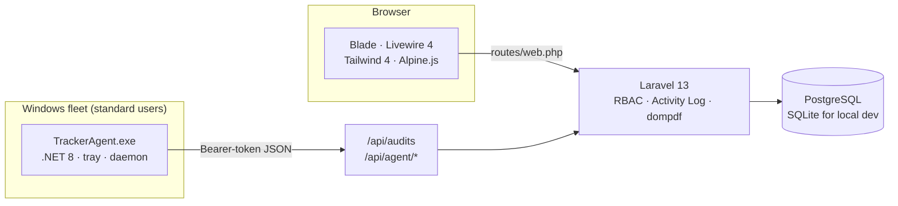

<div align="center">

# TRACKER-ASSET


**Web-based IT Asset Management, IT Audit & FAT Generator for MITO Group.**
The browser-based successor to the legacy Windows `ITAuditMITO` desktop workflow.

**Inventory · Live Fleet · MATCH/MISMATCH audits · FAT/BAST PDFs · QR & barcode · RBAC · Entra SSO**

</div>

---

## ✨ Highlights

- **🖥️ Live Fleet** — `/agent/fleet` shows every laptop's telemetry (battery health, disk space, RAM layout, Wi-Fi, online/offline) with 30-second auto-refresh.
- **🖱️ 1-click agent install** — the download embeds the server address (config trailer), so double-clicking `TrackerAgent.exe` installs itself: no URL or token to type, **no UAC prompt**, works on standard-user accounts.
- **🔁 "Scan Again" that really scans** — queue a hardware rescan from any asset page; the laptop answers within its 10-second poll and the audit lands on the asset.
- **⚖️ Server-side comparison** — MATCH / MISMATCH is computed entirely in Laravel, so results never depend on the collector.
- **📄 FAT / BAST in one click** — auto-populated documents with sequential numbering, A4 PDF, preview/print, plus IKE BAST receiving-inspection tables.
- **📊 Excel round-trip** — import with column mapping, validation preview and duplicate detection; filtered, logged CSV export.
- **🔐 RBAC + immutable Activity Log** — admin / support / technician / viewer via policies & gates; every mutation is trailed.
- **🪪 Microsoft Entra ID SSO** — OAuth/OIDC code flow with auto-provisioning (opt-in).
- **🔁 Agent auto-update** — push *Update All* from the web; daemon downloads, verifies and swaps itself.

## 🗂 Modules

### Asset Management

| Module | Status |
|---|---|
| Asset CRUD + search / filter / sort / pagination | ✅ Done |
| Asset Detail (overview, assignment/audit/repair history, documents, activity log) | ✅ Done |
| Excel Import (mapping, validation, preview, duplicate detection, confirm) — see `docs/import-workflow.md` | ✅ Done |
| Excel Export (filtered, logged) | ✅ Done |
| Dashboard (KPI, charts, warnings, recent activity) | ✅ Done |
| Transfer Workflow (atomic, assignment history, sequential numbering) | ✅ Done |
| Repair History | ✅ Done |
| Master Data CRUD (Companies / Locations / Categories / Statuses, delete protection) | ✅ Done |
| QR Code (per-asset PNG) + Barcode/QR scan page | ✅ Done |
| Attachments Upload (validated, logged) | ✅ Done |
| Reports (summary, breakdowns, audit coverage, CSV export) | ✅ Done |

### Audit & Agent Fleet

| Module | Status |
|---|---|
| Audit — server-side MATCH/MISMATCH comparison, mismatch detail — see `docs/audit-workflow.md` | ✅ Done |
| Audit Agent API (token-authed JSON) — see `docs/audit-api.md` | ✅ Done |
| Audit Agent — .NET 8 single-file exe (tray, daemon, self-update) | ✅ Done |
| Audit Agent — one-shot + resident PowerShell collectors | ✅ Done |
| Fleet Command Center `/agent/commands` — Scan Now / Scan All / Update All, online status, history | ✅ Done |
| **Live Fleet `/agent/fleet`** — telemetry cards, battery/disk bars, 30s auto-refresh, per-device Scan & Reinstall | ✅ Done |
| **Zero-config 1-click installer** — server URL baked into the download via config trailer | ✅ Done |
| Asset-page **Scan Again** — queues a real scan command to the enrolled laptop | ✅ Done |
| Barcode / QR scan page (barcode, QR, Asset ID, serial, hostname) | ✅ Done |

### Documents & FAT / BAST

| Module | Status |
|---|---|
| FAT / BAST (auto-populate, configurable numbering, A4 PDF, preview/download/print) — see `docs/document-workflow.md` | ✅ Done |
| Document Generation (auto-populate from asset data) | ✅ Done |
| Document Templates (CRUD) | ✅ Done |
| IKE BAST Inspection Table (multi-line receiving inspection, approve/reject, print-friendly) — see `docs/ike-bast-inspection.md` | ✅ Done |

### Platform & Security

| Module | Status |
|---|---|
| Authentication — local dev mode | ✅ Done |
| Microsoft Entra ID SSO (OAuth/OIDC code flow, auto-provision, config-gated) | ✅ Done |
| RBAC — admin / support / technician / viewer via policies + gates | ✅ Done |
| Users management (local, admin only) | ✅ Done |
| Activity Log page (immutable trail, filter + pagination) | ✅ Done |
| Microsoft Graph / SharePoint — profile sync done; file storage pending | 🟡 Partial |
| CI/CD — GitHub Actions (PHPUnit + Pint); CD to VPS pending go-live | 🟡 Partial |

## 🤖 Windows Audit Agent

`TrackerAgent.exe` is a .NET 8 single-file agent — no installer wizard, no prompts:

```text
download (server URL baked in) → double-click → auto-install to %LOCALAPPDATA% → first scan → visible on Live Fleet
```

- **Standard-user safe** — `asInvoker` manifest: the install never triggers UAC. State lives only in `%LOCALAPPDATA%\TRACKER` + `HKCU` (Run autostart); no HKLM, services, scheduled tasks or firewall rules.
- **Two modes** — one-shot CLI, or resident daemon with system tray (10-second inbox poll, self-update).
- **Fleet actions from the web** — Scan Now, Scan All, Update All, revoke.
- **Install from the daily-driver account** — deployment is per-user (HKCU).

Full guide: [`agent/README.md`](agent/README.md) · HTTP API: [`docs/audit-api.md`](docs/audit-api.md)

## 🏗️ Architecture



## 🧰 Tech Stack

| Layer | Choice |
|---|---|
| Backend | Laravel 13 · PHP 8.3+ |
| Database | PostgreSQL (production) · SQLite (local dev & tests) |
| Frontend | Blade · Livewire 4 · Alpine.js · Tailwind CSS 4 · Vite 8 |
| PDF / Excel | barryvdh/laravel-dompdf · maatwebsite/excel (PhpSpreadsheet) |
| QR / Barcode | simplesoftwareio/simple-qrcode |
| Windows agent | .NET 8 single-file exe (+ PowerShell alternatives) |
| Auth | Local (dev) · Microsoft Entra ID / OIDC (production) |
| Infra | Docker Compose · GitHub Actions |
| Tests | PHPUnit 12 · Laravel Pint |

## 🚀 Quick Start

**Docker**

```bash
docker compose up -d --build
docker compose exec app php artisan migrate
docker compose exec app php artisan db:seed
```

**Local (PHP + Composer)**

```bash
git clone https://github.com/masmbull/TRACKER-ASSET.git
cd TRACKER-ASSET
composer setup        # deps + .env + app key + migrate + npm build
php artisan db:seed
php artisan serve --port=8000
```

<sub>Manual equivalent: `composer install` → `cp .env.example .env` → `php artisan key:generate` → `php artisan migrate`. Local accounts & auth modes: [`docs/local-development.md`](docs/local-development.md).</sub>

## 🧪 Testing

```bash
php artisan test       # 290 tests · 1142 assertions (in-memory SQLite)
vendor/bin/pint        # code style (Laravel Pint)
```

CI runs the suite on **both** SQLite and PostgreSQL. Running only SQLite hides
two classes of bug that the production engine catches immediately: foreign keys
are not enforced there by default, and its rowid is reused after a rolled-back
test where a PostgreSQL sequence never rewinds. To run the second engine locally:
see [`docs/local-development.md`](docs/local-development.md).

## 📚 Documentation

| Doc | Covers |
|---|---|
| [`docs/architecture.md`](docs/architecture.md) | High-level design & module map |
| [`docs/local-development.md`](docs/local-development.md) | Environment setup & auth modes |
| [`docs/deployment.md`](docs/deployment.md) | Production deployment |
| [`docs/database-schema.md`](docs/database-schema.md) | ERD & table reference |
| [`docs/audit-workflow.md`](docs/audit-workflow.md) | Audit comparison rules |
| [`docs/audit-api.md`](docs/audit-api.md) | Agent HTTP API |
| [`docs/m365-directory.md`](docs/m365-directory.md) | Microsoft 365 employee directory |
| [`docs/import-workflow.md`](docs/import-workflow.md) | Excel import pipeline |
| [`docs/document-workflow.md`](docs/document-workflow.md) | FAT/BAST & numbering |
| [`docs/transfer-workflow.md`](docs/transfer-workflow.md) | Ownership transfer flow |
| [`docs/ike-bast-inspection.md`](docs/ike-bast-inspection.md) | Receiving inspection tables |
| [`docs/backup-recovery.md`](docs/backup-recovery.md) | Backup runbook |
| [`docs/asset-data-mapping.md`](docs/asset-data-mapping.md) | Excel column mapping |
| [`TRACKER-ASSET-PRD.md`](TRACKER-ASSET-PRD.md) | Full product requirements |

## 🔄 CI / CD

- [`ci.yml`](.github/workflows/ci.yml) — PHPUnit + Pint on every push / PR
- [`pint-fix.yml`](.github/workflows/pint-fix.yml) — automatic code-style fixes
- CD to VPS — pending go-live 🟡

## 📂 Repository

**https://github.com/masmbull/TRACKER-ASSET**
