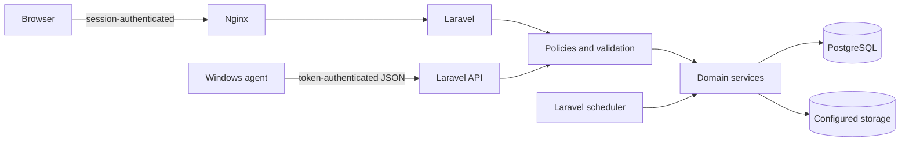

# Architecture and trust boundaries

## Overview

TRACKER-ASSET is the system of record for IT assets, assignment history, audits, generated
documents, agent enrollment, and operational activity. Excel is an import/export format,
not a database. The Windows agent collects readings; Laravel owns validation, comparison,
authorization, and persistence.

## Runtime components

| Component | Responsibility |
|---|---|
| Browser | Responsive Blade/Livewire UI, Alpine interactions, forms and modal workflows |
| Nginx | HTTP entry point, static built assets, FastCGI forwarding |
| Laravel 13 / PHP 8.4 | Web/API routes, business services, policies, audit rules, PDF generation |
| PostgreSQL | Persistent application data and document metadata |
| Redis | Optional cache/session/queue backend; configured per deployment |
| Scheduler | Periodic stale-command resolution and scheduled audit work |
| TrackerAgent (.NET 8) | Windows inventory collection, heartbeat, polling and command execution |
| Local/object storage | PDFs, attachments, agent releases; configured per deployment |

Tailwind CSS 4 and Vite build the front end. Dompdf generates PDFs, Laravel Excel handles
spreadsheet workflows, and Simple QR Code renders labels. Microsoft Entra ID and Microsoft
Graph are optional integrations, not prerequisites for local login.

## Request and data flow

## Core workflows

1. **Assets:** register/import → validate → persist asset and history → search/filter/export.
2. **Transfers:** validate current and destination assignment → write assignment/transfer
   history in a transaction → log the actor.
3. **Audits:** agent posts readings → Laravel resolves an asset and compares fields → save
   MATCH/MISMATCH/unknown result → a human chooses whether to update registered data.
4. **Fleet:** authenticated agent polls and reports → UI displays health → authorized
   operator queues a command → agent acknowledges/reports progress → UI tracks completion.
5. **Documents:** choose a template in a modal → choose/confirm the asset and type → form is
   prefilled → Laravel validates and renders PDF → metadata, payload, and activity are saved
   → document remains available under `/documents` and on the asset record.

## Security and reliability principles

- Authorization is server-side (policies and gates); hiding a UI action is not authorization.
- Agent tokens are scoped, revocable, and stored as hashes. Treat the one-time issued value
  as a secret and deliver it only through approved channels.
- The app does not seed shared/default user passwords. Provision the initial admin with
  `php artisan tracker:admin:create` from an interactive trusted terminal.
- Keep `.env`, signing keys, user passwords, and agent tokens out of Git and documentation.
- One dependency failure must not prevent the service monitor from reporting other probes.
- Dynamic authenticated HTML/JSON and API polling must not be served cache-first by the PWA.
- Preserve activity and assignment history; changes to registered asset data are explicit.

## Environments

- **Local:** Docker Compose, local authentication, PostgreSQL, Redis, and Mailpit. SQLite is
  available for quick tests.
- **Production:** versioned container image, PostgreSQL, Redis, a separate scheduler,
  storage volumes, and Nginx behind HTTPS. See [`deployment.md`](deployment.md).
